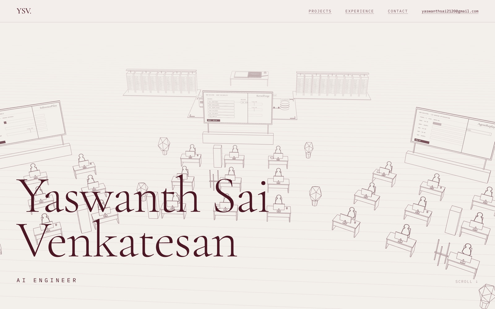
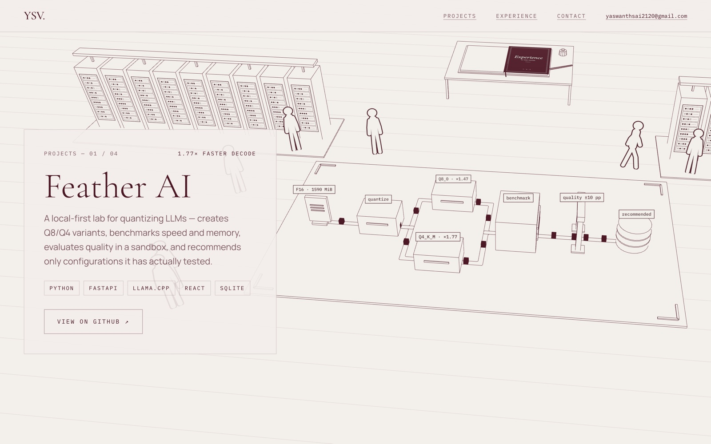
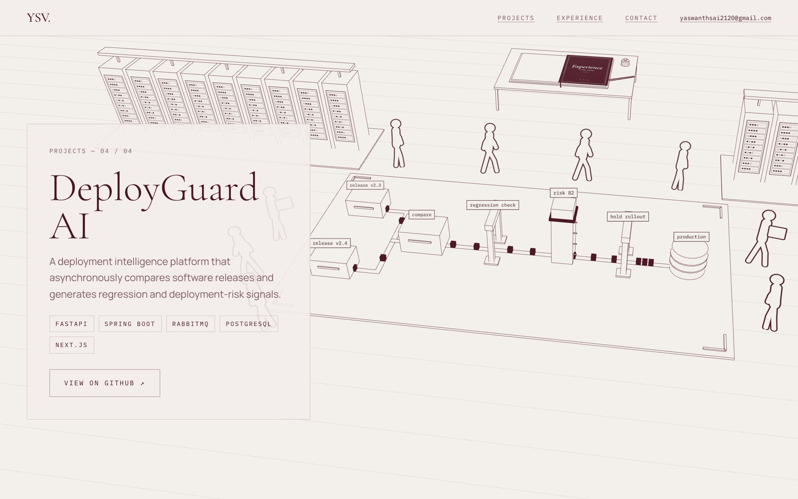
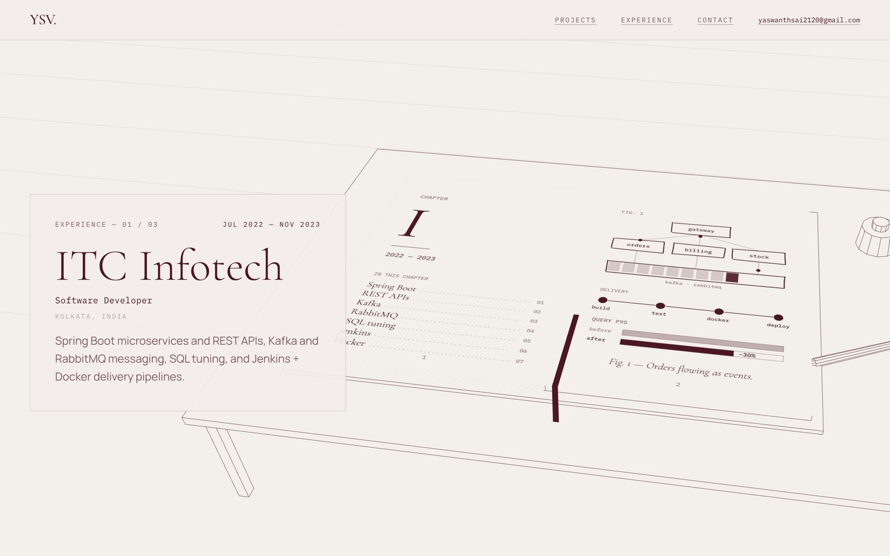
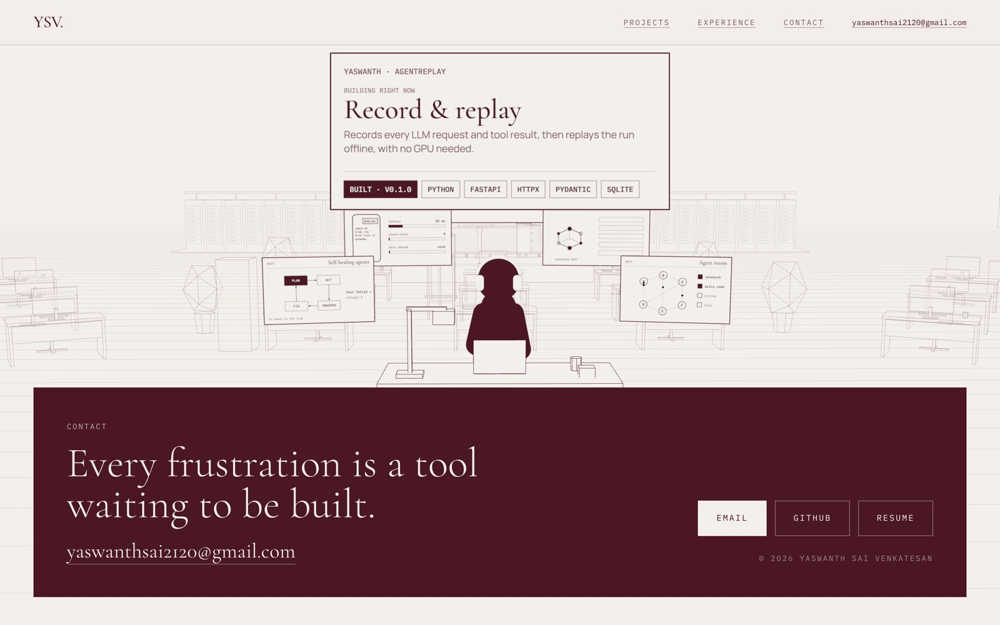
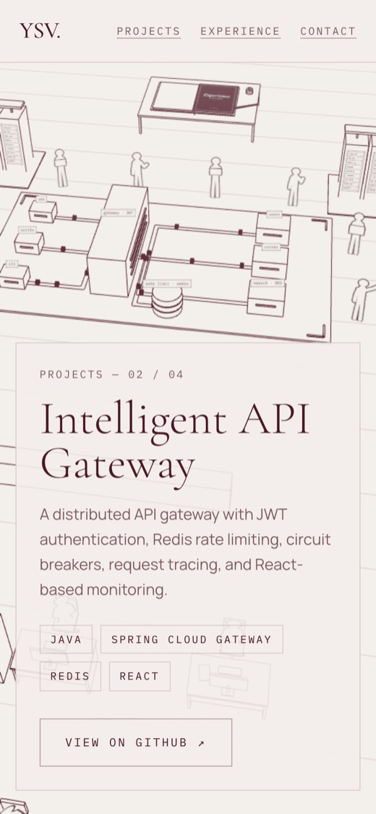
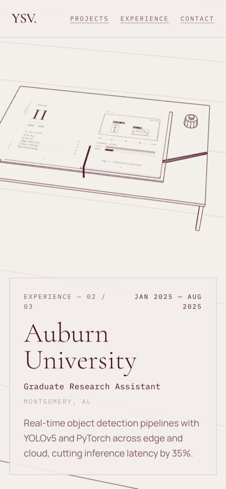
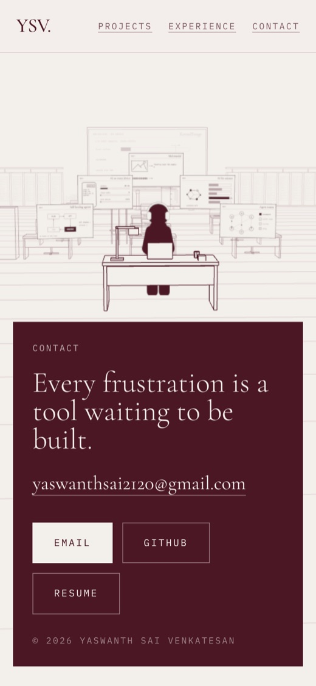

# Yaswanth Sai Venkatesan — Portfolio

A scroll-driven 3D portfolio set in a single office, drawn entirely in two colours: porcelain and oxblood line art. Every part of the office is always standing (the desks, the model floor, the server room, the book at the back, the final desk at the front). Each scroll moves the camera to the next part of the office.

**Live:** <https://yaswanthsai-venkatesan.vercel.app>



## A walk through the office

### Home: the office at work

A curved office of 27 people across three project zones. Each zone has a wall screen showing one of the live projects (AgentReplay, InferencePilot, KernelForge), and the projects rotate across the screens. Click a person at a desk to see the feature they're working on; click them again to see the next one.

### Projects: the model floor

The wall screens lower into their cabinets to clear the view, and the camera moves to the model floor. Each project builds itself there as a working miniature:

1. The components rise out of the floor one by one.
2. Tracks are laid between them.
3. Data packets run through the system.

Each system behaves like the real thing. Requests over the rate limit bounce back at the gateway, and DeployGuard's risky release queues up at its "hold rollout" gate. Nine of the team work around the model. Scroll on and the current system sinks into the floor while the next one builds: Feather AI, Intelligent API Gateway, DocuIntel AI, then DeployGuard AI.





The book is visible on its table at the back of the office in every project shot.

### Experience: the book

The camera settles over a shut, clothbound book on a writing table. The cover opens, then the title page turns. Each role is a chapter:

- **The left page** holds the chapter numeral, the years and the tools.
- **The right page** holds an animated figure of the work.

Each new chapter turns one page. Every turn plays in full over about a second, however fast you scroll. The current chapter is still being written.



### Contact: one engineer

The camera rises over the whole office and comes down at the front. There, the team merges into one figure at a desk, and five screens about where AI is heading fan out above it. The office stays behind, dimmed.

Click the figure to see what Yaswanth is building right now. Each click shows the next feature, rotating through the three live projects.



### On a phone

<table>
  <tr>
    <td></td>
    <td></td>
    <td></td>
  </tr>
</table>

Every scene respects `prefers-reduced-motion`, which shows a still frame for each section. Phones get a lighter version of the scene.

## Design system

- **Colour:** porcelain `#F3EFEB` and oxblood `#4B1724` only. Variations come from opacity; there are no other hues, gradients or shadows.
- **Type:** Cormorant Garamond (display), Manrope (body), IBM Plex Mono (labels).
- **3D style:** porcelain faces with oxblood edge lines, same-colour fog, and flat 2D pictogram people that always face the camera.

## How it works

- **One scroll position drives everything.** The page is a column of sections, one per stop. `scroll.s` is a fractional stop index (for example, 2.5 is halfway between the second and third project). The camera, the people, the fades and the screens are all functions of it, defined in `choreography.js`.
- **Animations that must be seen play over time, not with the scroll.** The model building itself and the book's page turns are triggered by the scroll position but then run on a clock, so a fast scroll can't skip them.
- **Everything on a surface is drawn on `<canvas>` at runtime.** The wall screens, cards, labels, book pages and people are canvas textures, rendered at 1.5–4× their layout size so they stay sharp on high-density displays. The site has no image assets apart from the favicon and the résumé PDF; the screenshots above are only for this README.

## Tech stack

- React 19 + Vite 5
- Three.js with `@react-three/fiber`
- Tailwind CSS v4
- React Router (the home page plus `/resume`)
- Deployed on Vercel

## Run locally

```bash
git clone https://github.com/Yaswanth2120/yaswanth-portfolio.git
cd yaswanth-portfolio
npm install
npm run dev        # http://localhost:5173
```

```bash
npm run build      # production build into dist/
npm run preview    # serve the build locally
npm run lint
```

## Project structure

```text
src/
  data/content.js        All site copy: intro, live projects, projects, experience, education, contact
  pages/Home.jsx         Page sections (one per scroll stop), scroll tracking, card selection
  lib/scroll.js          Shared scroll position (a fractional "stop" index) read by the scene
  scene/
    OfficeScene.jsx      The 3D scene: office, people, wall screens, model floor, server room, book, final desk
    choreography.js      The office layout, where everyone is at each stop, camera keys, fades
    systems.js           The model floor: each project's system as nodes and links
    pictogram.js         The 2D people (poses drawn to canvas textures)
    screens.js           Drawing helpers, desk-monitor screens, server-rack lights
    demos.js             Live-project wall screens, agent cards, final screens
    book.js              The experience book's pages and animated figures
public/
  Yaswanth_Resume.pdf    Served at /resume
docs/screenshots/        Images for this README
```

## Editing content

Most edits only touch `src/data/content.js`:

- **Projects:** `projects.items` holds 4 entries. Each project's model is in `src/scene/systems.js` (the `SYSTEMS` array, in the same order), defined as nodes (services, stores, gates, models and so on) and the links packets travel along.
- **Live projects:** `liveProjects` holds 3 entries (one office zone each), with the features shown when you click a person or the final figure.
- **Experience:** `experience.items`. If you change how many roles there are, also update `JOBS` in `src/scene/choreography.js`. Each role's book figure is in `src/scene/book.js` (`FIGURES`).

The scroll timeline expects one page section per stop: intro, 4 projects, the roles, then contact.

## Deployment

Pushing to `main` deploys to production on Vercel. `vercel.json` rewrites every path to the single-page app, so `/resume` works on refresh.

## Branches

- `main`: the live site.
- `projects-model-floor`: the model-floor projects section before the office became one continuous space.
- `projects-drawing-machine`: an earlier projects section, a wall-mounted pen plotter that draws each system diagram live.
- `experience-the-walk`: an alternative experience section, "The Walk": monoliths rise along a path as you walk it.
